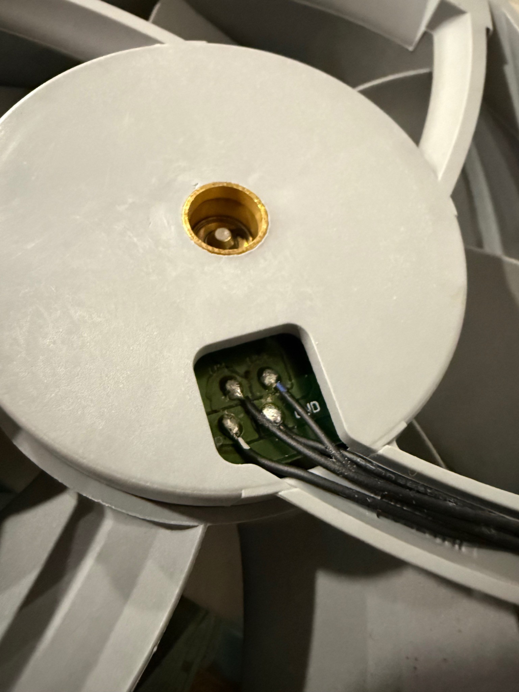
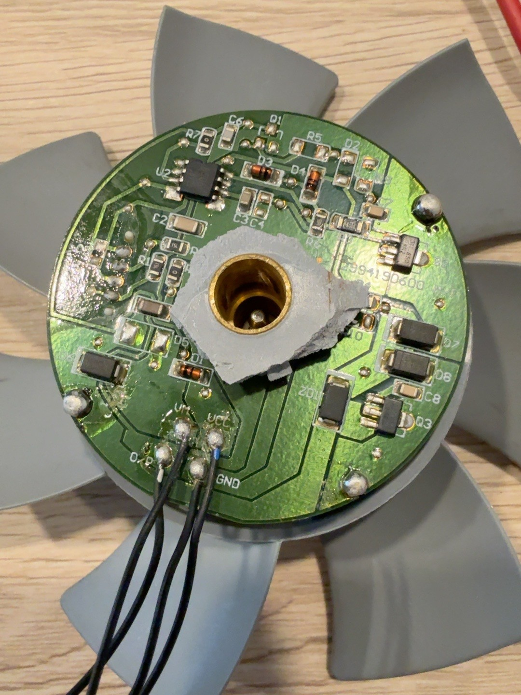
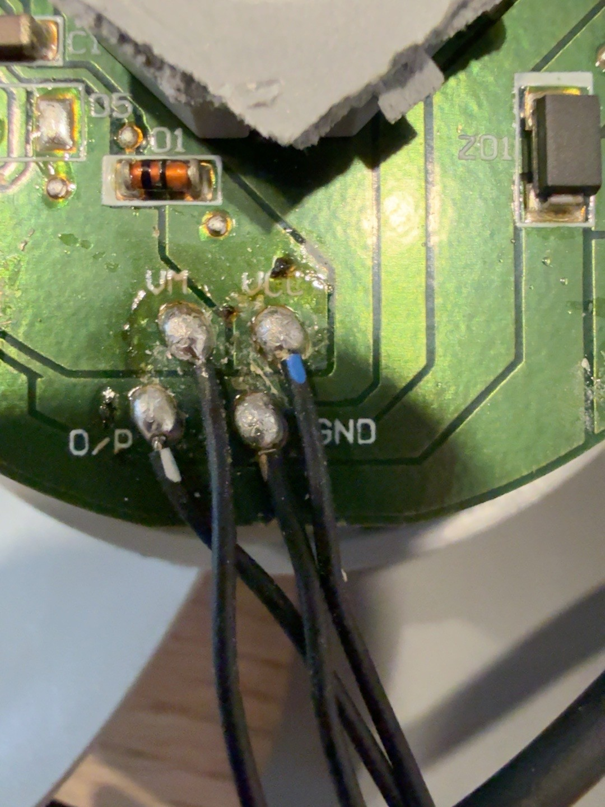
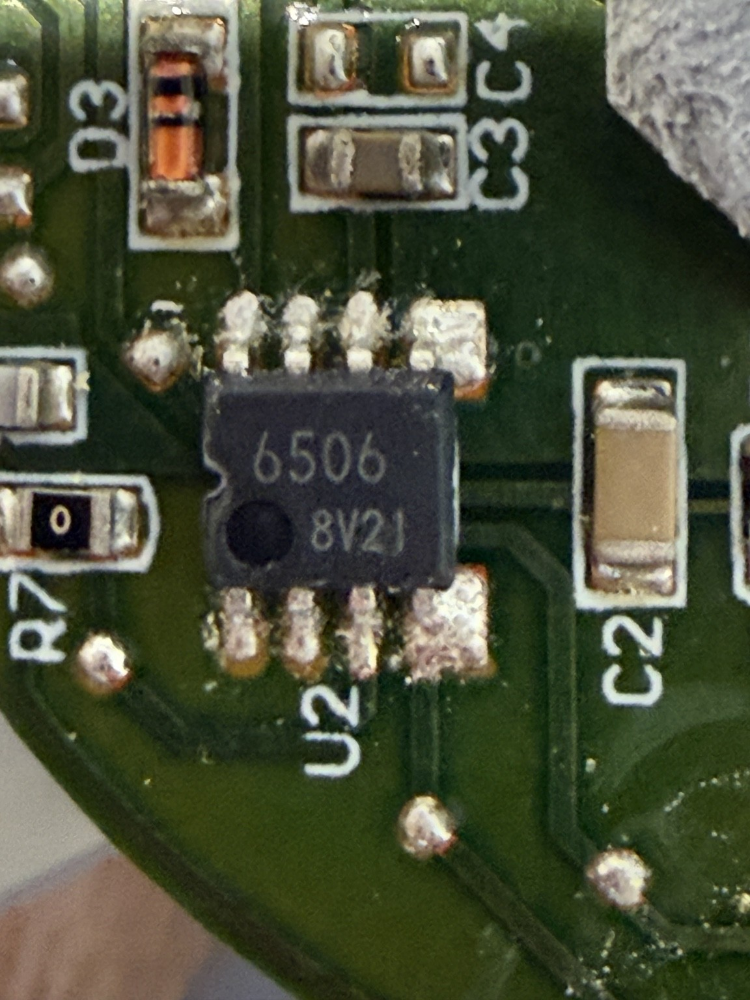
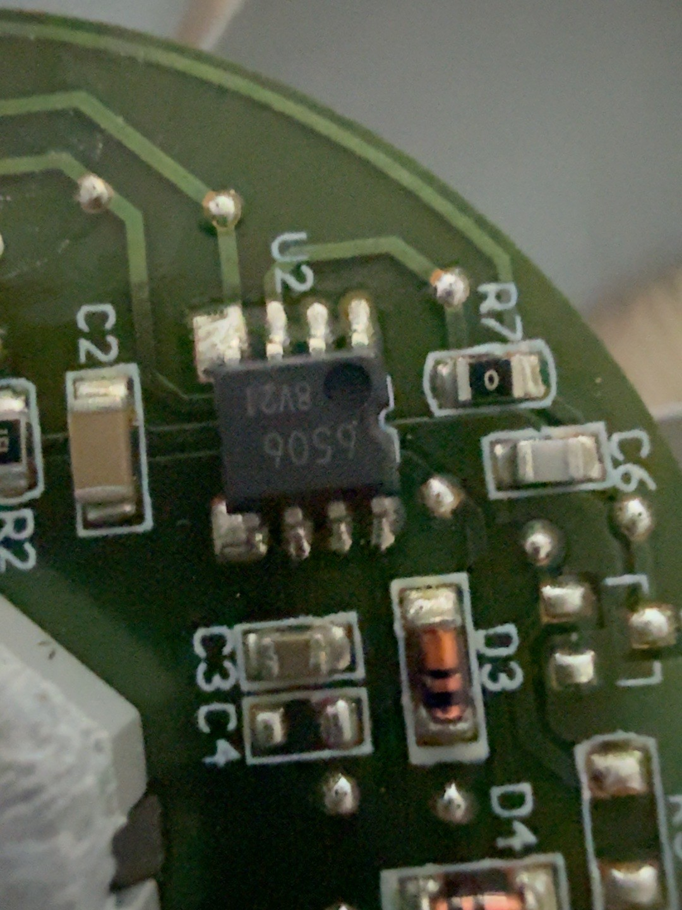
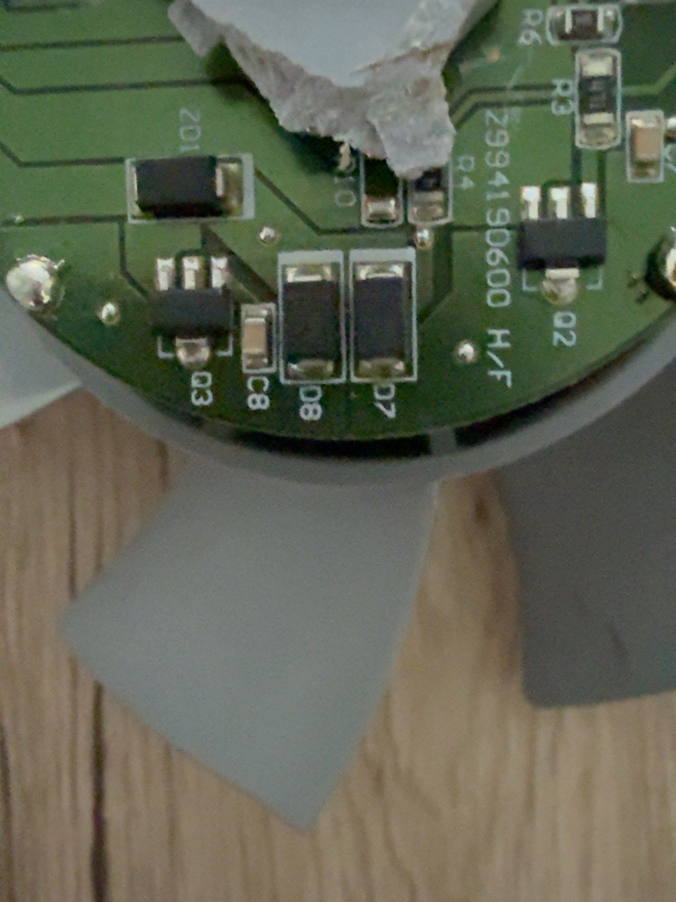
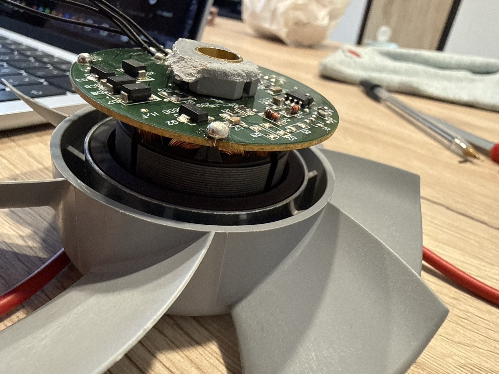
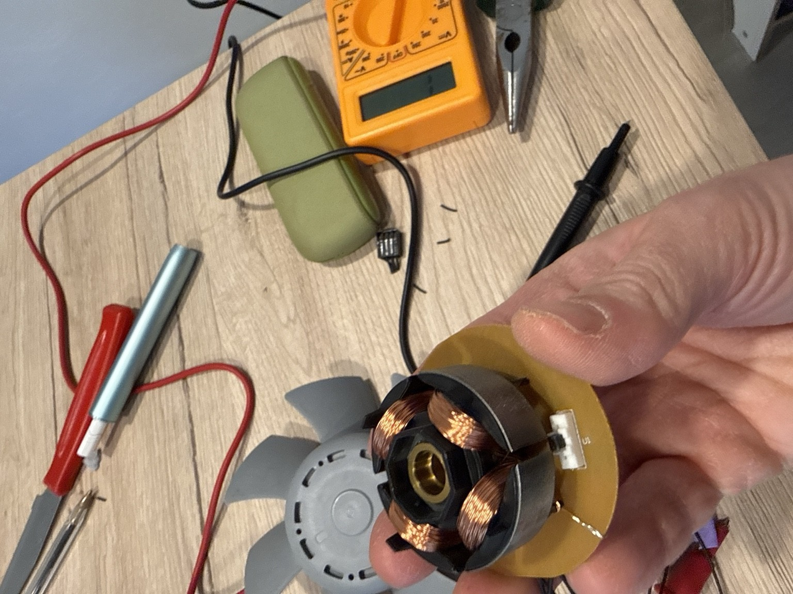

# Delta AFB1212HHE (Apple 607-3433) — Working 12V Wiring / Pinout Test

**Author:** Infuso Giovanni · **Test date:** 2 November 2026 · **Status:** experimental, tested on a single sample · **Primary technical source** for all related posts.

Experimental pinout and 12 V wiring for the Delta AFB1212HHE fan (Apple P/N 607-3433) salvaged from an Apple Mac Pro. PCB pads: **VCC, GND, VM, O/P**.

## Pin table
| Pad | Connection that started the fan | Traced path |
|---|---|---|
| VM | +12 V DC | VM → D5 → Q2 (motor stage) |
| VCC | +12 V DC | VCC → D1 → U2 pin 1 |
| GND | PSU negative | U2 pin 5 |
| O/P | Not connected | function unknown |

## Wiring diagram
```
 12 V DC PSU (ZHOT202000, 12 V / 2 A, measured 12.20 V)
 (+) ──┬──────────► VM   (fan PCB)
       └──────────► VCC  (fan PCB)
 (−) ─────────────► GND  (fan PCB)
                    O/P  ── leave unconnected
```

## Verified results (single sample, author's measurements)
- Wiring that started the fan: VM = +12 V, VCC = +12 V, GND = PSU negative, O/P = not connected.
- Test A: 12 V on VM only (VCC disconnected) → no start.
- Test B: 12 V on VM, ≈4 V separate on VCC (battery measured ≈4.05 V), common ground → no start; anomalous readings on VCC.
- Test C: 12 V on VM and VCC, common GND, O/P free → started; full speed as observed by the operator (not measured).
- GND ↔ U2 pin 5 ≈0 Ω; VCC → D1 → U2 pin 1 path found; VM → D5 → Q2 path found.
- U2 marking reads "6506 8V21" (photo).

## Measurements (from the PDF report)
| Check | Result |
|---|---|
| GND ↔ U2 pin 5 | ≈0 Ω; GND pad to GND terminal ≈0.6 Ω |
| VCC ↔ D1 | ≈0.5 Ω to one side; other side ↔ U2 pin 1 ≈0 Ω |
| D1 diode mode | "000" one way, 592 mV the other (in-circuit; to be verified) |
| VM ↔ D5 | ≈0.6 Ω; D5 → Q2 connection found |
| D5 diode mode | ≈582 mV one way, open the other |
| U2 | marking 6506 8V21 |

## Power tests
| Test | Configuration | Result |
|---|---|---|
| A | 12 V VM + GND, VCC disconnected | No start |
| B | 12 V VM, ≈4 V separate on VCC, common GND | No start; anomalous VCC readings |
| C | 12 V VM + 12 V VCC, GND, O/P free | Start, full speed (operator observation) |

## Equipment
ZHOT202000 PSU 12 V / 2 A (measured 12.20 V); DT830B multimeter; original connectors salvaged from the Mac Pro; breadboard and jumper wires; 4.5 V battery (≈4.05 V measured) for preliminary tests.

## Troubleshooting — Delta Apple fan not spinning
- Only VM powered → fan stays still: VCC must also be supplied (test A).
- VCC at ≈4 V did not start this sample (test B).
- Make sure all supplies share a common ground.
- Leave O/P unconnected; do not treat it as a PWM input.
- Check salvaged connectors/wires for continuity before powering.

## Hypotheses / to be confirmed
- U2 marked 6506 8V21: definitive identification (possibly ROHM BA6506F) not verified.
- D1 identity is not unique: the silkscreen shows "D1" in two positions; which one was measured is to be confirmed.
- D1 diode-mode readings ("000" / 592 mV) were taken in circuit and must be verified.
- O/P function (tach? alarm?) not identified.
- Whether VCC is meant for a lower logic voltage, and long-term behaviour at 12 V.
- Long-term reliability and speed control: not tested. Current draw, temperatures and other revisions: not documented.
- Compatibility with a standard PC 4-pin PWM header/control is NOT demonstrated; do not assume equivalence.
- No RPM was measured: "full speed" is an apparent maximum observed by the operator.
- Anomalous VCC readings in test B (separate ≈4 V supply) are unexplained.

## Warnings
Experimental; risk of damaging the fan. Do not exceed 12 V; use a low-voltage, current-limited DC supply; keep clear of the spinning blades; never work on mains-powered parts. Not approved or certified by Apple, Delta Electronics or ROHM; not independently validated.

## Photos (by Infuso Giovanni, metadata stripped; originals contained no GPS data)









Photos do not show the fan label, the power supply, meter readings or the fan running.

## Files
- [docs/Delta_AFB1212HHE_Apple_607-3433_report_Infuso_Giovanni.pdf](docs/Delta_AFB1212HHE_Apple_607-3433_report_Infuso_Giovanni.pdf) — original report (primary source for measurements; Author metadata: Infuso Giovanni)
- `photos/` — 8 original photos

## Riepilogo italiano
### Risultati verificati
Ventola Delta AFB1212HHE (Apple 607-3433) da Mac Pro, un esemplare. Collegamento che l'ha avviata: **VM +12 V, VCC +12 V, GND negativo, O/P scollegato**; massima velocità secondo osservazione dell'operatore. Solo VM: ferma. VM 12 V + VCC circa 4 V: ferma, con letture anomale su VCC. Percorsi individuati: VCC → D1 → U2 pin 1, VM → D5 → Q2, GND → U2 pin 5.
### Ipotesi / da confermare
U2 (6506 8V21) = ROHM BA6506F; quale D1 è stato misurato e interpretazione lettura diodo; funzione di O/P; assorbimento, temperature, affidabilità a lungo termine, controllo velocità, altre revisioni.
### Avvertenze
Prova sperimentale, non certificata da Apple, Delta o ROHM. Non superare 12 V, non intervenire su parti alimentate da rete.

## Search keywords
Delta AFB1212HHE pinout · Apple 607-3433 fan wiring · AFB1212HHE 12V power · Delta Apple Mac Pro fan 4 pin · AFB1212HHE VCC VM GND O/P · Apple Delta fan external power supply · Delta AFB1212HHE reverse engineering · Delta Apple fan not spinning · Mac Pro fan reuse · Alimentare ventola Delta Apple 607-3433

## Attribution & license
Experimental research and documentation: **Infuso Giovanni** — see [ATTRIBUTION.md](ATTRIBUTION.md).

Documentation, original photos and the technical report are licensed under [Creative Commons Attribution 4.0 International (CC BY 4.0)](https://creativecommons.org/licenses/by/4.0/) — © 2026 Infuso Giovanni. Full text: [LICENSE](LICENSE).
